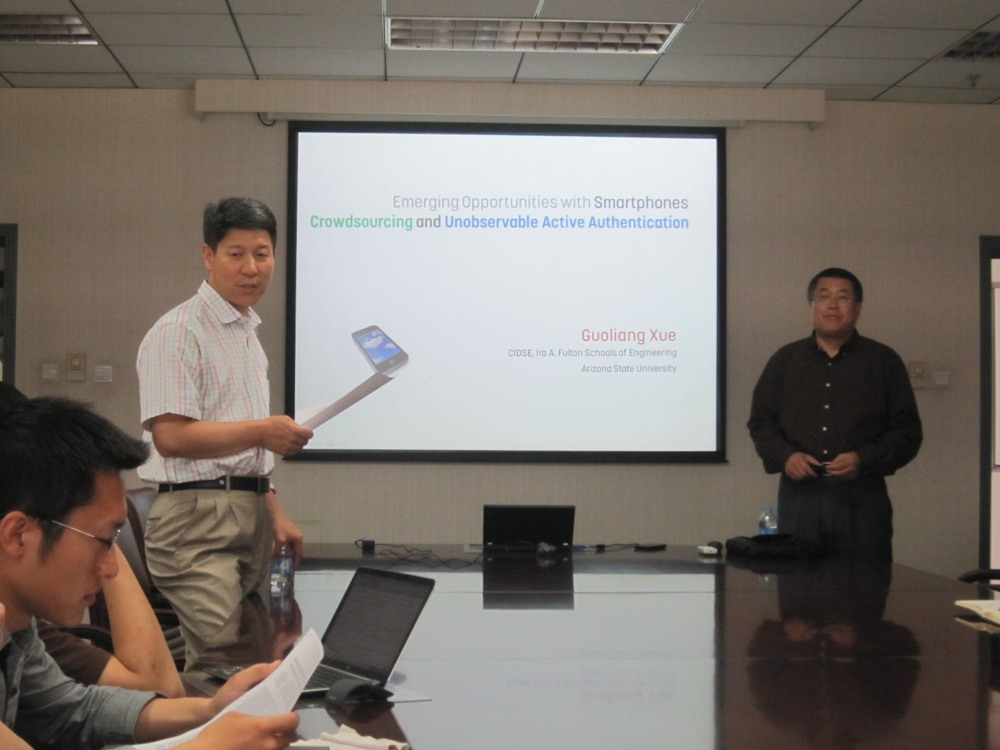

More and more people are adapting to smartphones, which are lightweight and provide extensive communication, computation, and sensing capabilities. These features make smart phones ideal for crowdsourcing, which is a new computing paradigm for human centric computing with collective intelligence. There are two challenges in crowdsourcing to smartphones. The first challenge is the need for an appropriate incentive mechanism, which can provide incentives for smart phone users to participate in crowdsourcing. The second challenge is active authentication of the user. To address the first challenge, we design incentive mechanisms for mobile phone sensing. We consider two system models: the platform-centric model where the platform provides a reward shared by participating users, and the user-centric model where users have more control over the payment they will receive. For the platform-centric model, we design an incentive mechanism using a Stackelberg game, where the platform is the leader while the users are the followers. We show how to compute the unique Stackelberg Equilibrium, at which the utility of the platform is maximized. For the user-centric model, we design an auction-based incentive mechanism, which is computationally efficient, individually rational, profitable, and truthful. To address the second challenge, we design a biometric based un-observable active authentication scheme for smartphones. Our scheme uses the sensors within the smartphones to capture the gestures of finger movement of the user of the smart phone. These gestures are used to decide whether the current user of the smart phone is the owner of the smart phone or not. Besides discussing what we know, this talk will also address several important open research issues in this area.