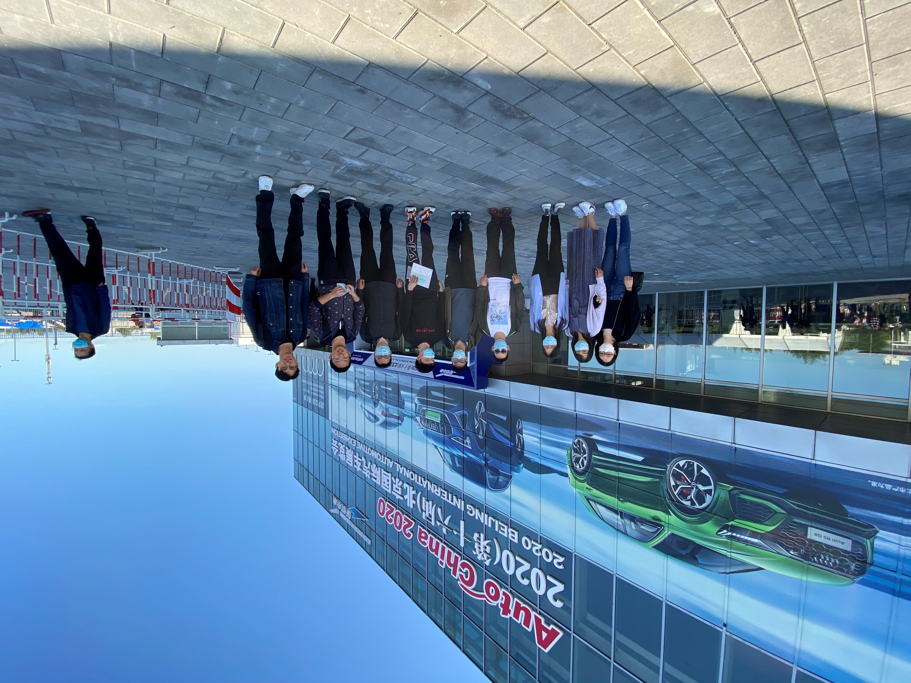
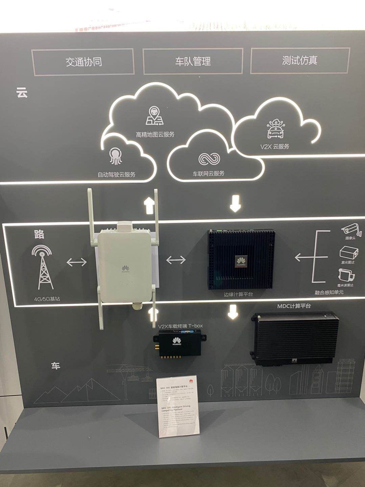
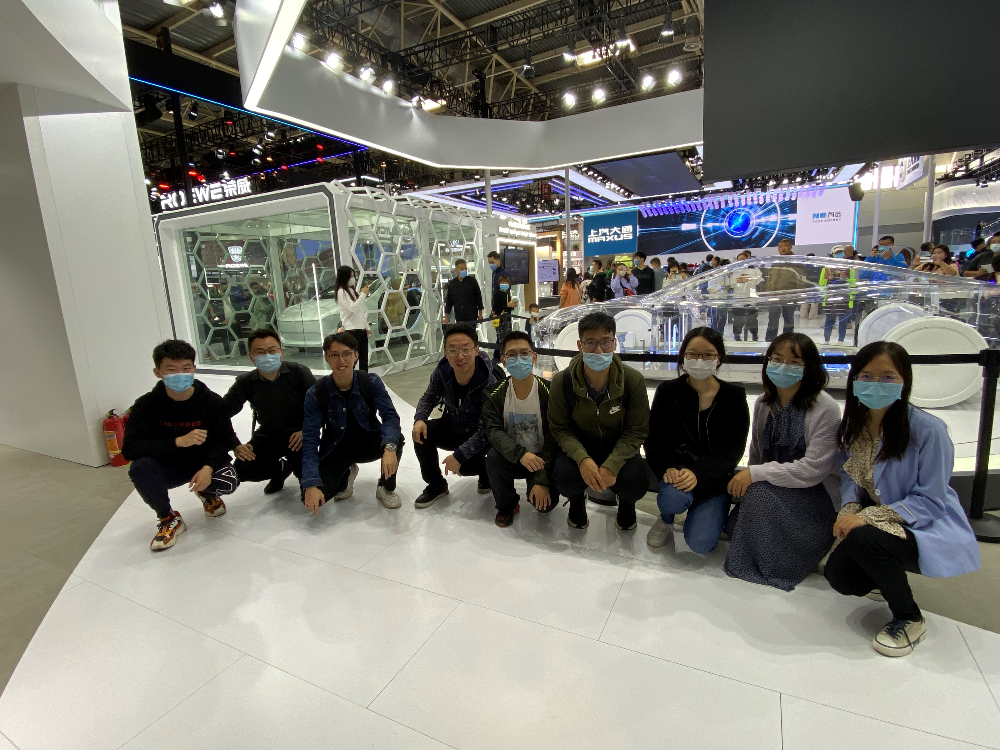
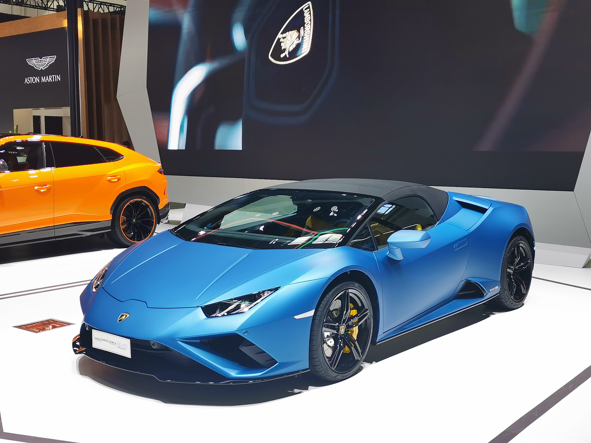
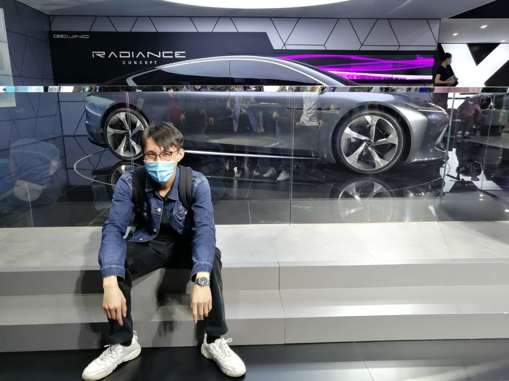
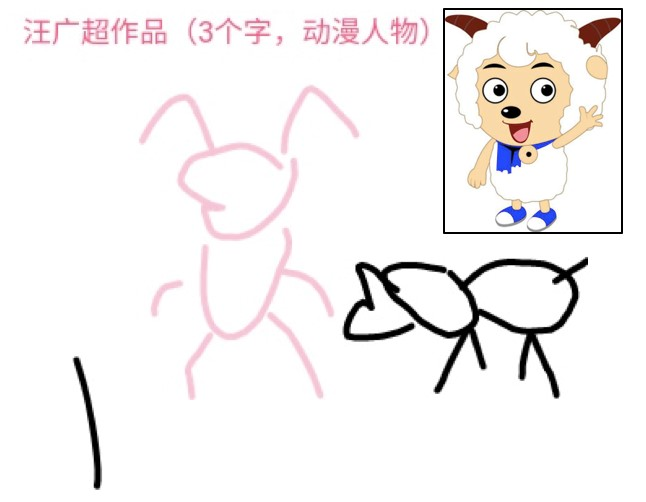
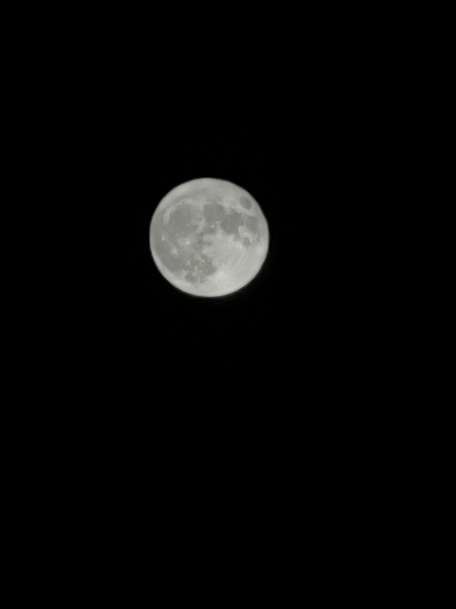

**Date:** October 2, 2020

On October 2, 2020, as China celebrated the 71st anniversary of the founding of the People's Republic of China, NiuLab students visited the Beijing International Automotive Exhibition to learn about the latest developments in the connected vehicle industry.

Our first stop was Huawei's exhibition booth, where staff introduced the company's intelligent computing platform built around three layers: cloud, road, and vehicle. They also showcased the internal structure of intelligent electric vehicles, and the group took a commemorative photo at the booth.

Next came free exploration time! Everyone eagerly recommended premium car models to our senior student Yuxuan, while Qicheng showed off his skills in front of the car models.

After the exhibition, we enjoyed a delightful dinner together at Tanglang Restaurant. The atmosphere was lively, and we played a round of *Pictionary* at the table. Guangchao, meanwhile, declared that he had never watched *Pleasant Goat and Big Big Wolf*!

Finally, as the Chinese saying goes, “The moon is fullest on the sixteenth day of the lunar month.” Using a Huawei P30, we captured the moon after the Mid-Autumn Festival and wished NiuLab continued growth and ever-greater success in research!

